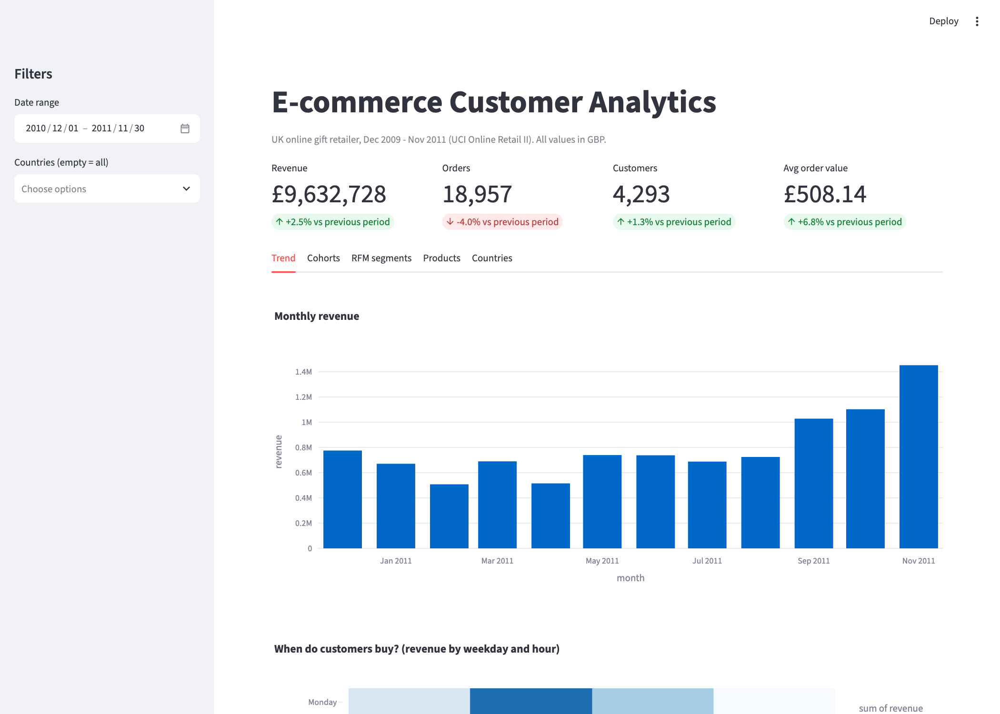
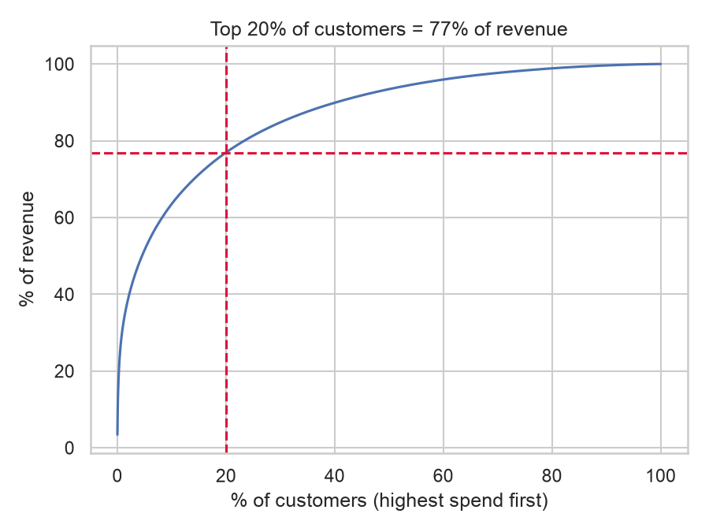
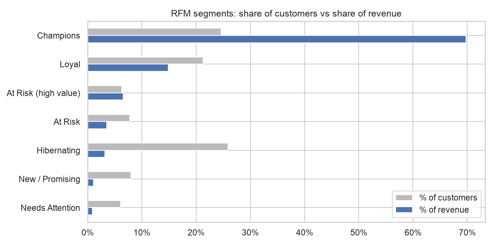
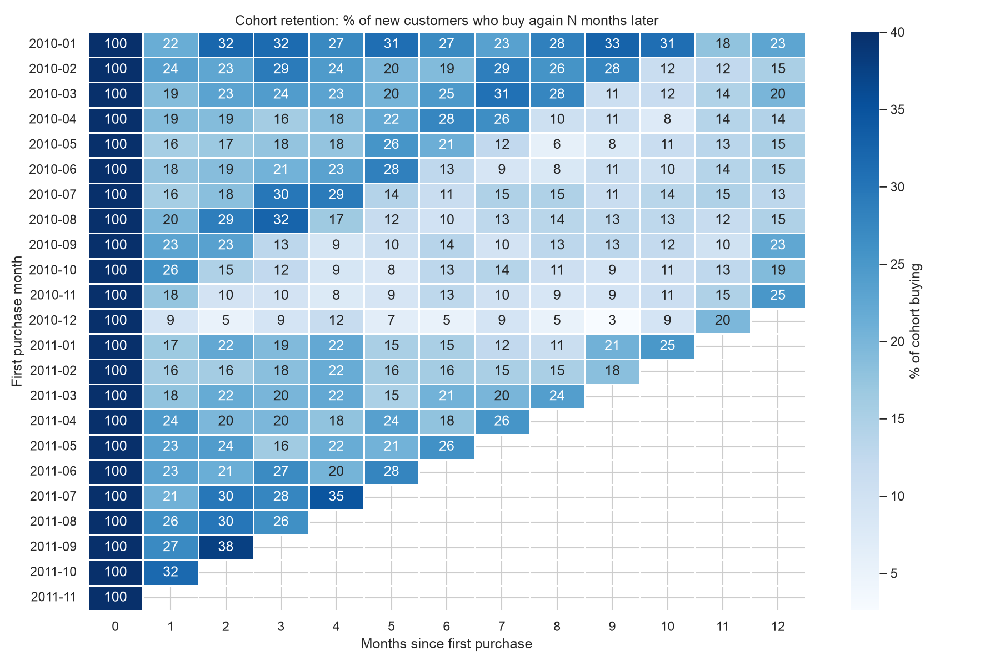
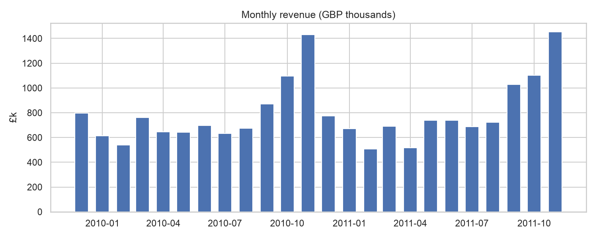

# E-commerce Customer Analytics: SQL, RFM Segmentation, Cohorts & Dashboard

End-to-end analytics on **1 million+ real transactions** from a UK online gift retailer: data cleaning in SQL, customer segmentation, cohort retention, market basket analysis, and an interactive Streamlit dashboard for business users.

   



## Business questions

1. Is the business growing, and where does growth come from?
2. Who are the most valuable customers, and who is about to be lost?
3. Do new customers come back?
4. Which products sell together (bundle and cross-sell ideas)?

## Key findings (Dec 2009 - Nov 2011)

| Metric | Value |
|---|---|
| Revenue, year 2 vs year 1 | **£9.63M vs £9.40M (+2.5%)** |
| Orders / avg order value, year 2 vs year 1 | **-4.0% orders, +6.8% order value** |
| Top 20% of customers share of revenue | **76.9%** |
| Customers who ordered more than once | **71.7%** |
| New customers buying again the next month (median cohort) | **20.2%** |
| Revenue lost to returns | **2.8%** |

**1. Growth comes from bigger orders, not more orders.** Order count fell 4% while average order value rose 6.8%. Recommendation: protect the large accounts and test minimum-order incentives; acquisition is not driving growth.

**2. Revenue is highly concentrated.** The top 20% of customers bring 77% of revenue, and the *Champions* segment (25% of customers) brings 70%. Three customers in Ireland alone bring £580k, 3% of total revenue - a key-account risk.

**3. £1.09M of past revenue is at risk.** 368 *At Risk (high value)* customers used to order often (7.5 orders on average) but have not bought for ~340 days. They are the best win-back target; the dashboard exports this list as a CSV for a campaign.

**4. Holiday shoppers do not come back.** The December 2010 cohort had only 9% month-1 retention vs ~20% for a typical cohort. Seasonal buyers need a different follow-up (e.g. a January offer) than year-round customers.

**5. Strong bundle candidates.** Some pairs sell together 80-90x more often than chance (lift), e.g. *Regency sugar bowl + milk jug* and children's garden tools in blue and pink. These are clear "frequently bought together" suggestions.

**6. Spain has a 13% return rate** vs 2.8% overall - worth a check of product quality or shipping for that market.

 





## Approach

### 1. Data cleaning in SQL ([`sql/01_clean.sql`](sql/01_clean.sql))

| Issue found | Rows | Fix |
|---|---|---|
| Exact duplicate rows | 34,335 | removed |
| Cancelled orders (invoice starts with `C`) | 19,104 | moved to a separate `returns` table |
| Non-product codes (postage, Amazon fees, manual adjustments, test items) | 4,633 | excluded |
| Zero or negative price / quantity | 5,961 | excluded |
| No customer ID (guest checkout) | 243,007 (raw) | kept for revenue KPIs (13% of revenue), excluded from customer analysis |
| **Result** | **1,003,338 clean product lines** | 1,067,371 raw rows -> 1,003,338 |
| December 2011 has only 9 days | - | analysis window ends 30 Nov 2011 |

### 2. Analysis in SQL

| File | What it does | SQL techniques |
|---|---|---|
| [`02_monthly_kpis.sql`](sql/02_monthly_kpis.sql) | revenue, orders, customers, AOV, YoY growth | CTE, `date_trunc`, `LAG` window |
| [`03_cohort_retention.sql`](sql/03_cohort_retention.sql) | monthly acquisition cohorts | CTEs, `date_diff`, joins |
| [`04_rfm_segments.sql`](sql/04_rfm_segments.sql) | Recency / Frequency / Monetary scores and segments | `NTILE` window, `CASE` rules |
| [`05_product_pairs.sql`](sql/05_product_pairs.sql) | market basket analysis (support, confidence, lift) | self-join, `HAVING` |
| [`06_country_returns.sql`](sql/06_country_returns.sql) | revenue share and return rate by country | window `SUM() OVER ()`, `LEFT JOIN` |

### 3. Dashboard ([`dashboard.py`](dashboard.py))

- KPI cards with change vs the previous period
- Filters: date range and country
- Tabs: revenue trend + weekday/hour heatmap, cohort heatmap, RFM treemap with **campaign list export**, top products and bundles, world map

## How to run

```bash
python -m venv .venv && source .venv/bin/activate
pip install -r requirements.txt
python -m src.run_analysis      # runs all SQL, writes reports/tables, reports/figures, reports/metrics.json
streamlit run dashboard.py
```

The cleaned data is included as a 7 MB Parquet file. To rebuild it from the original source run `python scripts/download_data.py`.

## Project structure

```
├── dashboard.py              # Streamlit dashboard
├── sql/                      # all business logic, one file per question
├── src/run_analysis.py       # runs SQL with DuckDB, saves tables and figures
├── scripts/download_data.py  # downloads raw data from UCI and converts to Parquet
├── data/                     # online_retail_ii.parquet (1,067,371 rows)
└── reports/                  # metrics.json, tables/*.csv, figures/*.png
```

## Limitations

- RFM segment rules are a common industry template; thresholds should be agreed with the marketing team.
- Customers in the first months of data may be older customers (the data starts in Dec 2009), so the Dec 2009 cohort is excluded.
- Revenue is gross of returns in the trend charts; returns are reported separately.

## Data

[Online Retail II, UCI Machine Learning Repository](https://archive.ics.uci.edu/dataset/502/online+retail+ii) (Chen, 2019), CC BY 4.0.
